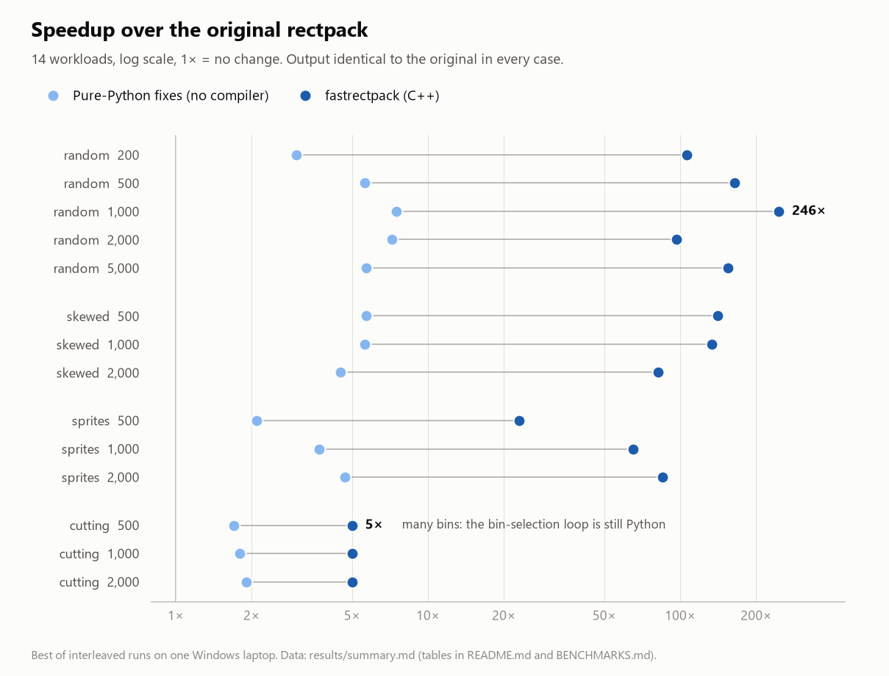

# fastrectpack

[](https://pypi.org/project/fastrectpack/)
[](https://github.com/p-ramcharan-dev/fastrectpack/actions/workflows/ci.yml)
[](https://github.com/p-ramcharan-dev/fastrectpack/actions/workflows/wheels.yml)


A drop-in accelerator for [rectpack](https://github.com/secnot/rectpack), the pure-Python 2D rectangle packing library. The MaxRects packing algorithms are re-implemented in C++17 and produce **exactly the same packings** as the original, 5x to 246x faster depending on the workload.

```python
# before
from rectpack import newPacker
# after: nothing else changes
from fastrectpack import newPacker
```

## Headline numbers

Default `newPacker()` settings. Times are the best recorded run; full method and all 14 cases are in [BENCHMARKS.md](https://github.com/p-ramcharan-dev/fastrectpack/blob/main/BENCHMARKS.md).

| Workload | Rectangles | Original rectpack | Pure-Python fixes only | fastrectpack (C++) | Speedup |
|---|---|---|---|---|---|
| random sizes | 1,000 | 3.525 s | 0.473 s | 0.0144 s | 246x |
| random sizes | 5,000 | 21.123 s | 3.738 s | 0.1364 s | 155x |
| few large, many small | 1,000 | 1.360 s | 0.243 s | 0.0102 s | 133x |
| sprite sizes | 2,000 | 1.500 s | 0.322 s | 0.0177 s | 85x |
| sheet cutting, 100 bins | 2,000 | 0.415 s | 0.214 s | 0.0780 s | 5x |

Two things to read from this table:

- **Part of the win needs no C++.** A better algorithm in plain Python gives 1.7x to 7.5x on its own (the "Pure-Python fixes only" column). The C++ port supplies the rest.
- **The gain depends on the workload.** Jobs that spread rectangles over many bins gain about 5x, because the bin-selection loop is still Python. See "What is not faster" below.

The benchmark machine is a laptop that drops into slow phases (probably thermal throttling), so absolute seconds vary by up to about 2.3x. Best-time speedup ratios agreed to roughly 10% between full runs.

<p align="center">
  <picture>
    <source media="(prefers-color-scheme: dark)" srcset="https://raw.githubusercontent.com/p-ramcharan-dev/fastrectpack/main/docs/benchmarks-dark.png">
    
  </picture>
</p>

## Install

```
pip install fastrectpack
```

Prebuilt wheels cover CPython 3.9 to 3.13 on Linux x86_64 (manylinux), Windows x86_64 and macOS arm64 (Apple silicon). Other platforms (Linux ARM, Intel Macs, Alpine/musl) and Python 3.14 are untested and build from the source distribution, which needs CMake 3.15+ and a C++17 compiler (MSVC 2019+, GCC 9+ or Clang 10+). From a checkout: `pip install .`. `rectpack==0.2.2` is installed as a dependency.

## Usage

Identical to rectpack:

```python
from fastrectpack import newPacker

packer = newPacker()
for width, height in [(100, 30), (40, 60), (30, 30), (70, 70), (100, 50), (30, 30)]:
    packer.add_rect(width, height)
packer.add_bin(300, 450)
packer.pack()

for bin_index, x, y, w, h, rid in packer.rect_list():
    print(bin_index, x, y, w, h)
```

`fastrectpack` re-exports everything rectpack exports. `MaxRectsBl`, `MaxRectsBssf`, `MaxRectsBaf` and `MaxRectsBlsf` are replaced by accelerated subclasses of the originals; everything else is the original object.

## How it works

The four MaxRects classes subclass the originals and run the algorithm in a small C++17 core while every size is a plain Python `int`. Anything else falls back, for good, to the original Python code for that object.

Profiling the original showed about 90% of its time in one step that compares every pair of free rectangles after each placement. The port compares only the pairs that involve newly created rectangles, which is valid because the list left by the previous step contains no rectangle that contains another. [docs/DESIGN.md](https://github.com/p-ramcharan-dev/fastrectpack/blob/main/docs/DESIGN.md) covers the design, exactly what "identical" means, and the known gaps.

## What is accelerated

| | Accelerated |
|---|---|
| MaxRects algorithms (Bl, Bssf, Baf, Blsf), with or without rotation | Yes |
| All bin heuristics (BNF, BFF, BBF, Global), online and offline modes, all sort orders | Yes, when used with a MaxRects algorithm |
| Sizes given as plain Python `int`, up to 2^30 | Yes |
| Sizes given as `float`, `Decimal`, numpy values or `bool` | No: handled by the original code with the same result, but **not faster, and slower in at least one measured case** (see "What is not faster") |
| Skyline and Guillotine algorithms | No: unchanged original code |

When an accelerated object meets an input outside the fast path, it hands its state to the original Python implementation and continues there, so results and error messages stay the same.

## What is not faster

- **Many-bin workloads.** With 100 open bins, most of the time goes to the Python loop that asks every bin how well a rectangle fits. That loop was left in Python, so the gain there is about 5x.
- **Non-integer sizes and numpy values.** Floats, Decimals and numpy scalars fall back to the original code, so there is no speedup. I originally described this as "original speed", but one measurement contradicts that: packing 300 and 1,000 rectangles with `numpy.float64` bin sizes (the way the gdsfactory package calls rectpack) took about 2x as long as plain rectpack (3.99 s against 1.85 s, and 106.8 s against 59.8 s). The output was identical. Until this is fixed, do not use fastrectpack where bin or rectangle sizes are not plain Python ints. I have not yet found the cause of the extra time.
- **Skyline and Guillotine.** Not ported.

## How correctness was checked

- **Exact parity.** After every single placement, the tests compare the fitness value, the placement and the complete list of free rectangles (including its order) against the original. 474 tests, including two Hypothesis property tests (300 and 150 generated cases) and all 200 packer configurations that use a MaxRects algorithm.
- **Edge cases.** Floats, Decimals, NaN, infinity, zero and negative sizes, booleans, strings, `None`, numpy integers, integers beyond the native range, exact fits, pieces larger than the bin. Results and exceptions match the original.
- **Benchmark outputs.** Every benchmark run hashes the full result of all three variants; all 14 cases are identical.
- **Sanitizers.** The suite passes under AddressSanitizer and UndefinedBehaviorSanitizer, both locally (GCC 15.2 in WSL) and on a GitHub Actions Ubuntu runner.
- **Mutation check.** Six deliberate bugs were injected into the C++. The tests caught five; the sixth (treating edge-touching rectangles as overlapping) only adds free rectangles that the next step deletes, so the output cannot change. I reasoned that through rather than proving it formally.
- **Platforms and Python versions.** In GitHub Actions the test suite ran inside every built wheel: Python 3.9, 3.10, 3.11, 3.12 and 3.13 on Linux x86_64, Windows x86_64 and macOS arm64. Locally it also passes on 3.13 and 3.11 on Windows.

Run them yourself:

```
pip install ".[test]"
pytest
python bench/run_bench.py --quick     # about a minute
python bench/run_bench.py             # full benchmark, several minutes
```

## Behaviour inherited from rectpack

These were found while porting. They are reproduced on purpose, not fixed, so that results match ([`research/original_bugs.py`](https://github.com/p-ramcharan-dev/fastrectpack/blob/main/research/original_bugs.py) demonstrates each):

- `validate_packing()` never compares the last rectangle with the others, so an overlap involving it goes undetected.
- `MaxRectsBl` documents a smallest-x tie-break but takes the first candidate.
- With the BBF bin heuristic, online `add_rect` returns `True`/`False` instead of the rectangle.

## Limitations

- Speed was measured on one Windows laptop only. Correctness is checked in CI on Linux, Windows and macOS (arm64), but speed on those systems has not been measured.
- The package subclasses rectpack internals and pins `rectpack==0.2.2`. A new rectpack release would need re-checking.
- An unpickled or deep-copied packer continues on the original Python code path: correct, but not accelerated.

## Contributing and security

Issues and pull requests are welcome; see [CONTRIBUTING.md](https://github.com/p-ramcharan-dev/fastrectpack/blob/main/CONTRIBUTING.md). The most useful report is a real workload where it is still slow. Please report security problems privately, as described in [SECURITY.md](https://github.com/p-ramcharan-dev/fastrectpack/blob/main/SECURITY.md).

## Credits and licence

Apache-2.0, the same licence as rectpack, of which this is a derivative work. rectpack is by SecNot. The MaxRects algorithms come from Jukka Jylänki, "A Thousand Ways to Pack the Bin" (2010). See [NOTICE](https://github.com/p-ramcharan-dev/fastrectpack/blob/main/NOTICE).
